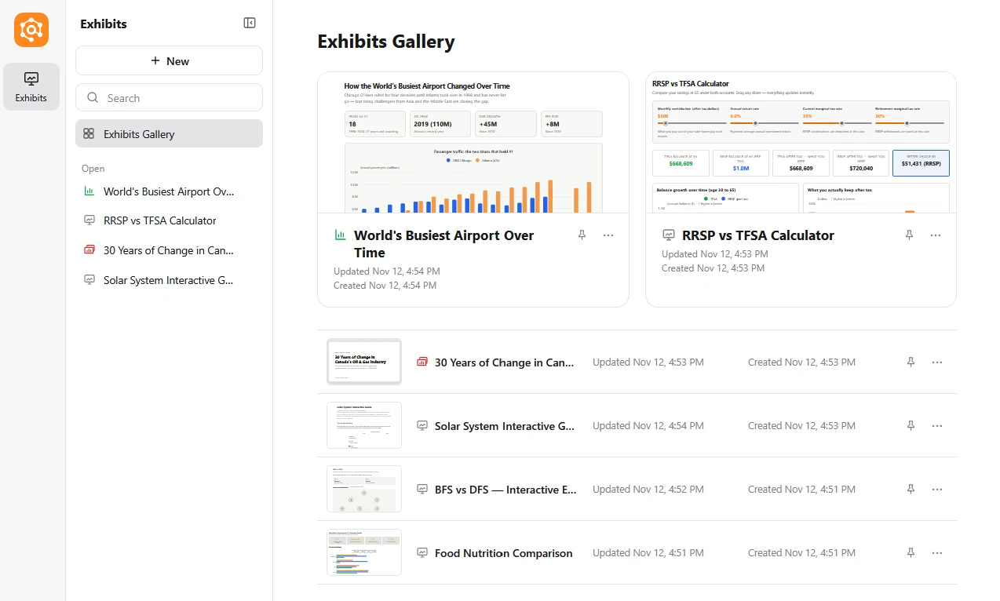
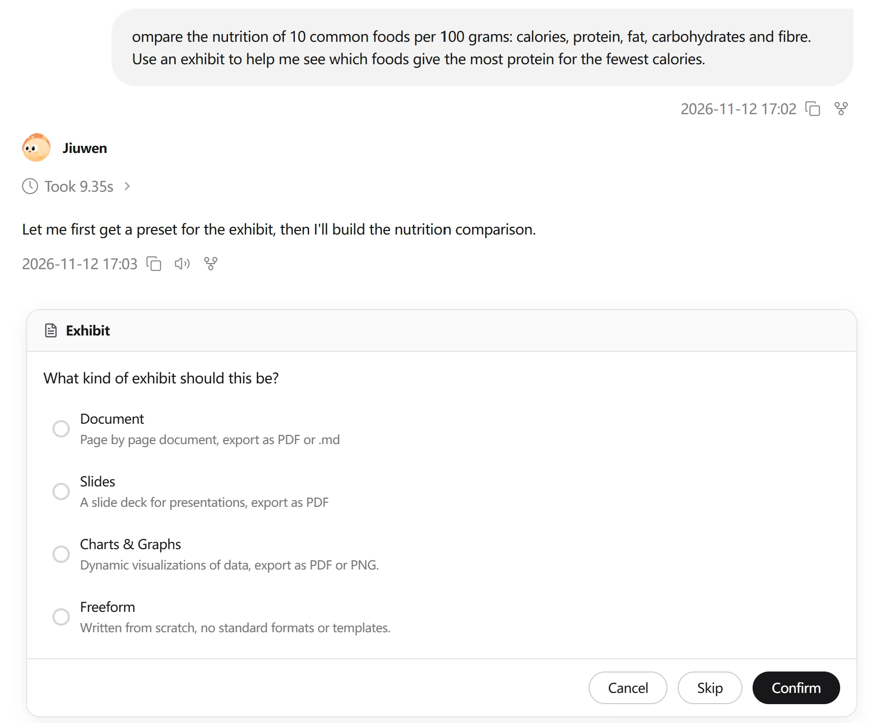
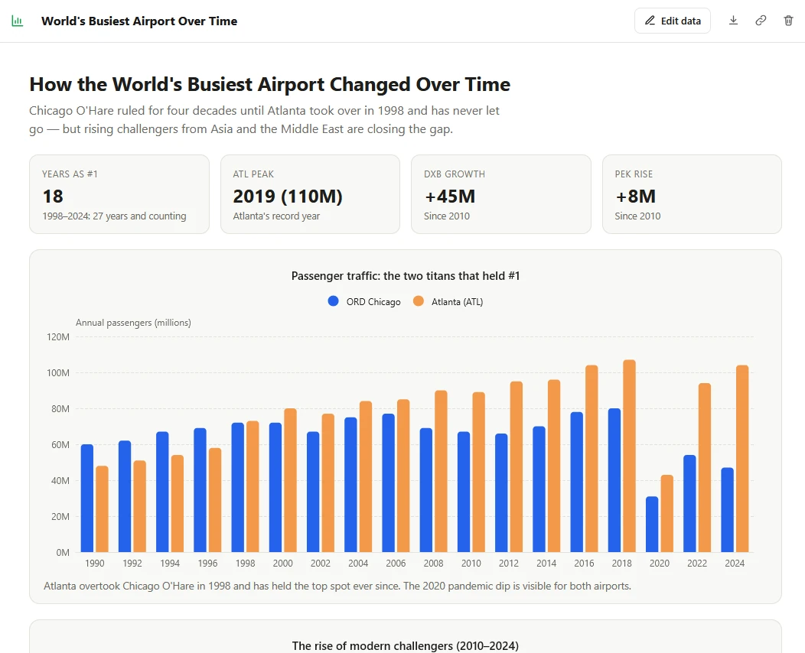
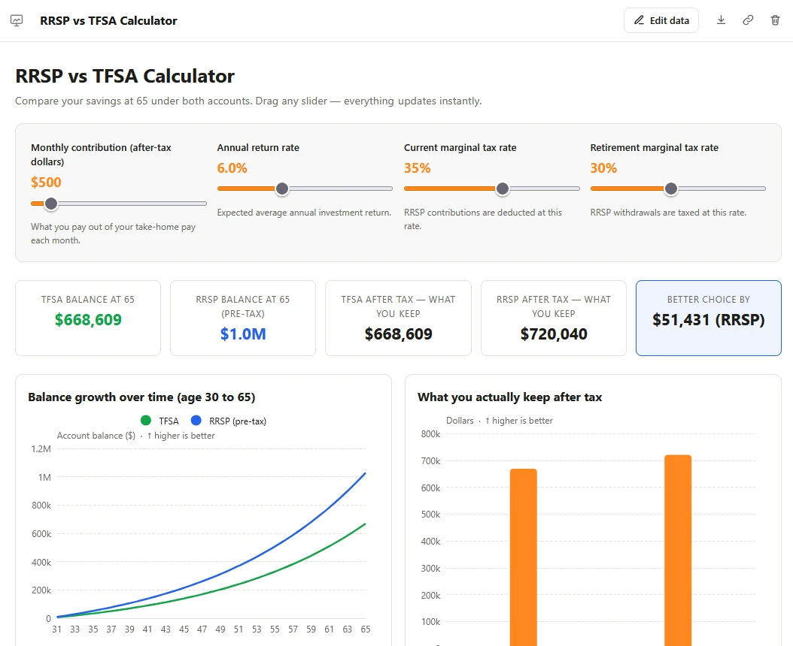

# Exhibits for WorkSwarm

A WorkSwarm plugin that lets the agent answer with a page instead of a chat message: a document, a slide deck, charts, or a freeform page (dashboard, calculator, tracker, explainer, etc). Exhibits open in your browser, keep their versions, can save what you enter, and can be exported.

Similar to artifacts in Claude and canvas in ChatGPT and Gemini.

**Status: 0.4.0** Tested with deepseek-v4-flash. Slides, charts and freeform are usually clean. For freeform, it works mostly if prebuilt componenent are widely majority.



## How it's built

| Part | What it is |
|---|---|
| Tool | `exhibit`, Python standard library only. Actions: `show`, `preset`, `list`, `gallery`, `read`, `open`, `delete`, `stop` |
| Rail | `ExhibitAskRail`, on WorkSwarm's `ask_user` interrupt |
| Skill | `skills/exhibit/`: when to make an exhibit, how to write one, and the presets |
| Server | Python `http.server` on `127.0.0.1` |
| Tests | 135 (87 tool, 48 rail), Python 3.11 with the real openjiuwen |

### Functions & Dependencies

| Used for | What |
|---|---|
| Charts | Apache ECharts 5.5.1, wrapped in the plugin's chart kit |
| Diagrams | Mermaid 12.3.0, wrapped in the plugin's diagram kit |
| PNG export | html-to-image 1.11.11 |
| Page check, PDF | Headless Edge or Chrome |
| Prebuilt UI Components | Standardized set that is easy to use, can be modified|

### Plugin - Tool

- Declares itself directly visible, so WorkSwarm's progressive tool loading doesn't hide it behind `tool_search`.
- **Presets:** sample pages in `plugin/exhibit/skills/exhibit/presets/`. A new version in another format (`preset_locked`) or missing the preset's structure (`preset_structure`) is refused.
- **Page check:** before the agent replies, the page is opened in headless Edge.
  - Refused: read-only tables of numbers, navigation menus / sticky headers / "back to top" on freeform pages, emojis in headings, buttons and labels.
  - Notes back to the agent: script errors, diagrams that didn't draw, text too small to read, a value axis with no name, prose put in boxes, a heading that repeats the chart title, a score bar on its own, page CSS restyling the page parts, reference lists numbered twice.
- **Libraries:** downloaded once from jsDelivr at pinned versions into `~/.exhibit/lib`, checked against SHA-256 hashes in the plugin, and served locally. Works offline after that.

### Plugin - Rail

- Asks for the format before a new exhibit. Confirms every delete.
- One question at a time (WorkSwarm takes one answer at a time).
- Makes the agent load the skill before showing anything.
- Fills in the page the agent just saved when `show` arrives without one.
- Keeps `.html` files with scripts out of the file preview panel.
- Stops an identical failing call after 3 tries in a turn.
- Runs just before the permission rail and removes its answer after reading it, otherwise the permission rail denies the resumed call.

### Storage and server

- `~/.exhibit/exhibits/<exhibit_id>/`: `v1.html`, `v2.html`, …, `meta.json`, `data.json`. Set `EXHIBIT_HOME` to move it.
- Server starts in the agent process on first use: `127.0.0.1`, random port, secret token in every URL (`/<token>/e/<exhibit_id>`).
- The outer page (title, page control, versions, export) is trusted. The exhibit runs in `<iframe sandbox="allow-scripts …">` without `allow-same-origin`, and its own response has a CSP `sandbox` too.
- Saved data: `window.exhibit.get/set/remove/all/clear`, sent by `postMessage` to the outer page, which is the only caller of the data API. 1 MB per exhibit.

## Using it

Ask for something that suits a page. Before a new exhibit, a dialog asks for the format: Document, Slides, Charts & Graphs, Freeform, or Answer in chat (if you didn't ask for an exhibit). Edits to an existing exhibit aren't asked about and become new versions. The agent replies with a link that opens in your browser.



### Formats

| | Document | Slides | Charts & Graphs | Freeform |
|---|---|---|---|---|
| Looks like | US Letter pages | 16:9 slides | Chart cards and stat tiles | Anything |
| Top bar | Page control ‹ 2 / 8 › | Slide control, arrow keys, swipes | Edit data | Edit data, if it has charts |
| Export | HTML, PDF, Markdown | HTML, PDF | HTML, PDF, PNG | HTML |

A format can't be changed after the exhibit is made. Page and slide controls are drawn by the plugin, so the agent's edits can't break them.

#### Document


- Same pages on screen and in the PDF. Paragraphs, tables and figures aren't split; headings stay with what follows.
- Sections, figures and tables number themselves.
- Layouts: report, one-page brief, memo/letter, meeting notes (action items can be ticked).

#### Slides


- Crowded slides shrink text down to 60%, then scroll.
- Reopens on the slide you were on.

#### Charts & Graphs



- Title, one-line takeaway, chart cards and stat tiles (total, average, highest, lowest, change, growth) computed from the data.
- **Edit data:** change values, add/remove/drag rows, reset. Charts and tiles redraw as you type, and edits are saved.

#### Freeform



Any single HTML page: widgets, calculators, checklists, step-throughs, drawn pictures, plus the charts, diagrams and page parts below. Results vary most here.

### Charts, diagrams and page parts

Available in every format, light and dark.

- **Charts:** line, area, bar, pie, donut, scatter, dot plot, histogram, box plot, heatmap, calendar heatmap, waterfall, funnel, treemap, sunburst, sankey, radar. Bars go sideways for long labels and stacked data. Value axes show units and which direction is better.
- **Diagrams:** flowcharts, sequence and state diagrams, Gantt charts, timelines, mind maps, database schemas, architecture, etc. Hover highlights and step-throughs.
- **Page parts:** callouts, panels, stat tiles, quotes, captions, sources, citations, tags, comparisons, term lists, numbered steps, meta rows, score bars. The agent can write its own when none fit.
- **Visuals that move:** explainers (sorting, graph search, simulations) are drawn by the agent in its own SVG or canvas, running the real steps, with Play, Step, Reset and speed. A Mermaid diagram can only light up boxes.

### When the agent uses what

The agent plans each section before writing: its point, and the fastest way to show it.

| Content | Form |
|---|---|
| Explanation, reasoning, findings | Plain paragraphs under headings. No cards, boxes or badges around prose; bold a phrase instead |
| Numbers | A chart, type picked by the question (change over time → line, ranking → sorted bar, parts of a whole → pie/treemap, two measures → scatter, etc). Breakdowns stay stacked or grouped |
| A process, structure or states | A diagram, with a step-through if there's an order |
| A plan or history | Gantt chart or timeline |
| Something physical (planets, a device, a place) | A drawn SVG picture, labelled, with scale stated |
| Something the reader can change | A widget, only if there's an input and an output that follows it |
| A list the user works through | Saved checkboxes |
| Tables | Only when asked, and editable |

Page parts each have one job:

- **Callout:** the one thing not to miss in a section, or key takeaways.
- **Panel:** a short set of related items.
- **Stat tiles:** 2 to 4 headline numbers.
- **Comparison:** strengths vs weaknesses, or A vs B.
- **Score bars:** only to compare 2+ items on one scale, never one alone.
- **Numbered steps, term lists, quotes, sources, citations, tags:** what their names say.

The agent shouldn't write CSS for page parts. If the user asks for a different look, its own CSS or the part variables (`--ex-accent`, `--ex-radius`, `--ex-soft`, `--ex-pad`) override them.

### Look and style

- **Colours:** WorkSwarm's logo orange (`#ff8821`) is the accent, with a darker orange (`#b85500`) for small text on white. Yellow = warning, green = good, red = bad.
- **Theme:** follows the system's light/dark setting. Every colour is a CSS variable; the agent doesn't pick dark itself.
- **Shapes:** square corners by default. Numbered steps are orange hexagons, like the WorkSwarm logo. Stat tiles and panels share the same soft background.
- **Charts:** titles centred, legend gets its own room, axis names kept inside the chart, stacked bars rounded only on the outer end.
- **No emojis** unless the user asks.

### Gallery, versions, data, export

- **Gallery:** previews, search, open exhibits as tabs, format icons, pinning. Rename, delete, copy reference from the ⋯ menu.
- **Versions:** every change is a new version, pick older ones from the top bar.
- **Saved data:** ticks, inputs, current slide, etc. The agent can read it.
- **Export:** HTML for all; PDF for documents, slides, charts; Markdown for documents; PNG for charts. PDFs are printed by headless Edge or Chrome, no print dialog.

### In chat

- **Reference an exhibit:** link icon in the top bar (or Copy reference in the gallery), then paste. The agent gets its versions, summary and saved data.

  ```
  @exhibit(Monthly budget #8d02e7) why is rent so high?
  ```

- **Quote part of one:** select text, click Quote, paste.

  ```
  @exhibit(Monthly budget #8d02e7)
  > Rent | $1,500 | Fixed
  ```

- Each exhibit records the chat it was made in, so the agent can look it up.
- Deletes are confirmed in a dialog. Deleting several shows one dialog.

## Plugin, and potential future integration with WorkSwarm

A plugin can't change WorkSwarm's frontend. WorkSwarm's HTML preview blocks scripts and its built-in browser refuses `localhost`, so exhibits open in the default browser. 9 of the 11 Hub plugins with interfaces we checked run their own `127.0.0.1` servers for the same reason.

The plan is for this to move into WorkSwarm:

- **Show exhibits inside the app** in a side panel, scripts enabled, isolated origin. The gallery already follows WorkSwarm's UI so it can become a side menu entry.
- **Support MCP Apps** (SEP-1865), the MCP extension for interactive UI that several AI clients already support, so plugins and connectors don't each need a server.
- **Keep the rest:** formats, presets, chart and diagram kits, page parts, page check, versions, saved data, export.

Current limits:

- Exhibits open in the browser. The way back is the chat link or the gallery.
- PDF export needs Edge (built into Windows 10/11) or Chrome.
- No web images; the agent draws pictures instead.
- The New exhibit panel isn't connected to the chat yet. Page labels are English only.

## Build and install

Download `exhibit-0.4.0.zip` and add it in WorkSwarm under Extensions.
