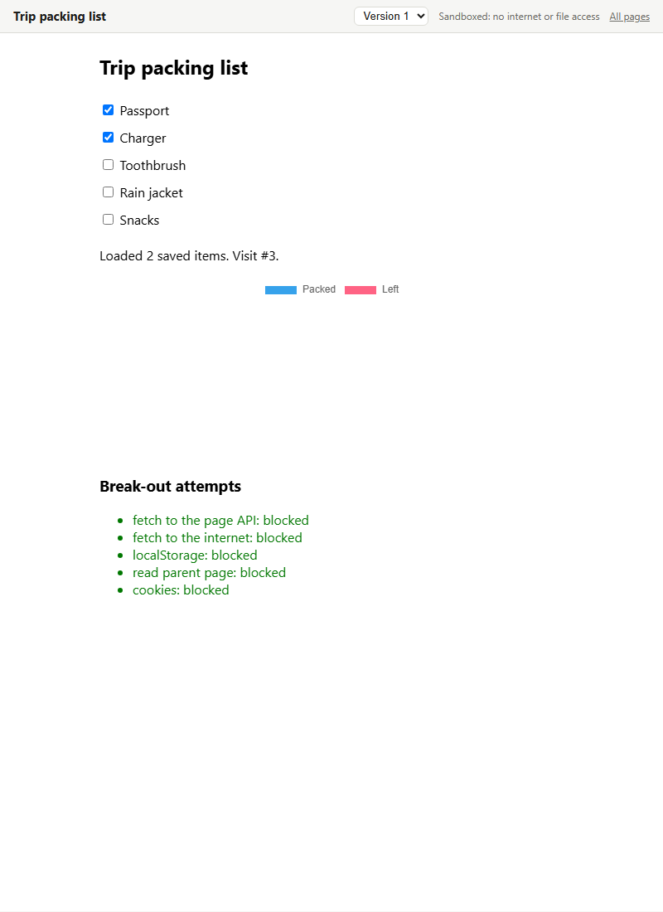

# Exhibit: interactive exhibits for WorkSwarm (prototype)

Exhibit lets the WorkSwarm agent build exhibits: interactive pages like dashboards, calculators, checklists, forms, charts and small games, opened in a sandboxed browser tab. Each exhibit keeps its versions and can save what the user enters, which the agent can read back.

It's a prototype of Claude-style artifacts for WorkSwarm. ("Artifact" already means self-improvement outputs in WorkSwarm's backend, so each item here is an *exhibit*.) WorkSwarm's own HTML preview blocks scripts, and its built-in browser refuses `localhost`, so a plugin can only open exhibits in the user's default browser. The longer-term fix belongs in WorkSwarm itself (see "Why a plugin" below).



## How it works

- **One tool, `exhibit`**, with actions `show`, `list`, `gallery`, `read`, `open`, `delete` and `stop`. Standard library only. It declares itself directly visible, because WorkSwarm's progressive tool loading would otherwise hide it behind `tool_search`.
- **One rail, `ExhibitAskRail`**, which pauses `show` for a new exhibit and asks the user "Exhibit or answer in chat?" through the same interrupt WorkSwarm's `ask_user` uses. It skips the question when the user's message mentions an exhibit, or they already chose Exhibit in this chat. Picking Exhibit lets the paused call run; picking chat cancels it and tells the agent to answer in chat. This is enforced in code because the agent skipped the question when it was only an instruction. The rail runs just before WorkSwarm's permission rail and removes its answer after reading it, since the permission rail otherwise denies the resumed call. The dialog's Skip counts as "show the exhibit" and Cancel stops the call.
- **Storage:** `~/.exhibit/exhibits/<exhibit_id>/` holds `v1.html`, `v2.html`, …, `meta.json` and `data.json`. Set `EXHIBIT_HOME` to move it.
- **Server:** a small HTTP server on `127.0.0.1` with a random port, started inside the agent process on first use. Every URL includes a secret token. Exhibits open at `/<token>/e/<exhibit_id>`.
- **Sandbox:** the user sees a trusted outer page (title, version picker) with the exhibit inside an `<iframe sandbox="allow-scripts …">` without `allow-same-origin`. The exhibit's own response also carries a CSP `sandbox` directive, so it stays sandboxed even if opened on its own.
- **Pages:** every page has a rail modeled on WorkSwarm's (its logo, read from the WorkSwarm install, and an Exhibits button that also reopens a collapsed column) and a collapsible Exhibits column with a New exhibit button (not hooked up yet), search over all exhibits, an All exhibits link, and open exhibits as tabs, newest first. Tabs and the column's collapsed state are kept in `~/.exhibit/tabs.json` and `ui.json`, since the server's port changes each session. The Exhibits page lists exhibits newest-created first: as many large cards as fit in one row, then the rest as list rows with a small thumbnail, the name, and when it was updated and created.
- **Saved data:** the exhibit calls `window.exhibit.get/set/remove/all/clear`. These go by `postMessage` to the outer page, which is the only thing allowed to call the data API.

### Security checks

| Threat | Defense |
|---|---|
| Exhibit reads other exhibits' data or calls the server | Opaque origin (sandbox without `allow-same-origin`), `connect-src 'none'` |
| Exhibit sends saved data to the internet | `connect-src 'none'`, `form-action 'none'`, images limited to `data:`/`blob:`; scripts and styles only from three CDNs |
| Websites the user visits call the server | Secret token in every path; data API refuses requests whose `Sec-Fetch-Site` isn't `same-origin` or whose `Origin` doesn't match |
| DNS rebinding | `Host` must be `127.0.0.1:<port>` or `localhost:<port>` |
| Outer page framed by another site | `frame-ancestors 'none'` |
| Prompt injection via saved data | The skill tells the agent to treat saved data as user input, not instructions |

Known gaps: scripts from the three CDNs are trusted; an exhibit can still beacon out through a CDN URL it builds (`script-src` allows those hosts). Any process running as the same Windows user can read `~/.exhibit`.

## Verified

- **End to end in WorkSwarm 0.2.7** (model deepseek-v4-flash):
  - the agent sees the tool and loads the skill;
  - a vague chart request brings up the "Exhibit or answer in chat?" dialog, with the agent's own description of the chat alternative;
  - picking Exhibit saves the exhibit and opens it in the default browser.
- 49 unit tests (30 for the tool, 19 for the rail), passing on Python 3.12 and on 3.11 (WorkSwarm's version) with the real openjiuwen (`python -m unittest discover -s plugin/tests`).
- The rail's pause, resume and permission-rail ordering, run against openjiuwen's real interrupt code (AgentStudio venv, openjiuwen 0.1.17).
- Sandbox in headless Microsoft Edge (as "Live Pages", before the rename to Exhibit):
  - the exhibit loaded data saved earlier, and saved a visit counter on each load (3 over 3 loads);
  - it drew with Chart.js from jsDelivr;
  - all five break-out attempts were blocked: server API, internet fetch, `localStorage`, reading the outer page, cookies;
  - the agent's `read` action returned the saved values.

## Known limitations (0.2.0)

- **Exhibits open in the browser, not inside WorkSwarm.** The way back to one is the link in the chat, or the Exhibits page and its tabs.
- **The New exhibit button isn't hooked up yet,** and page labels are English only.
- **Exhibits look plain.** The agent, especially a fast model, tends to plot every row and repeat the same data in several places.
- **The agent writes the HTML before the user is asked,** so choosing "Answer in chat" wastes that work.
- **The dialog's Skip and Cancel buttons** are handled from WorkSwarm's develop source, but haven't been clicked in a live test.
- **Reinstalling the same version** may keep the old copy. Remove Exhibit under Extensions before importing a new build.

## Build and install

```powershell
powershell -ExecutionPolicy Bypass -File plugin\package.ps1
```

This writes `plugin\dist\exhibit-0.2.0.zip`. Import it in WorkSwarm under Extensions, the same way as the Obsidian CLI plugin.

## Why a plugin, and what WorkSwarm itself should do

A plugin can't change WorkSwarm's frontend, so exhibits open in a separate browser tab. Nine of the eleven Hub plugins with interfaces that we checked already run their own `127.0.0.1` servers for this; Exhibit could replace those one-off servers. The proper fix is in WorkSwarm: render exhibits inside the app with scripts enabled in an isolated origin, and support **MCP Apps** (SEP-1865), the interactive-UI extension Claude and ChatGPT use, so connectors can bring their own interfaces.
