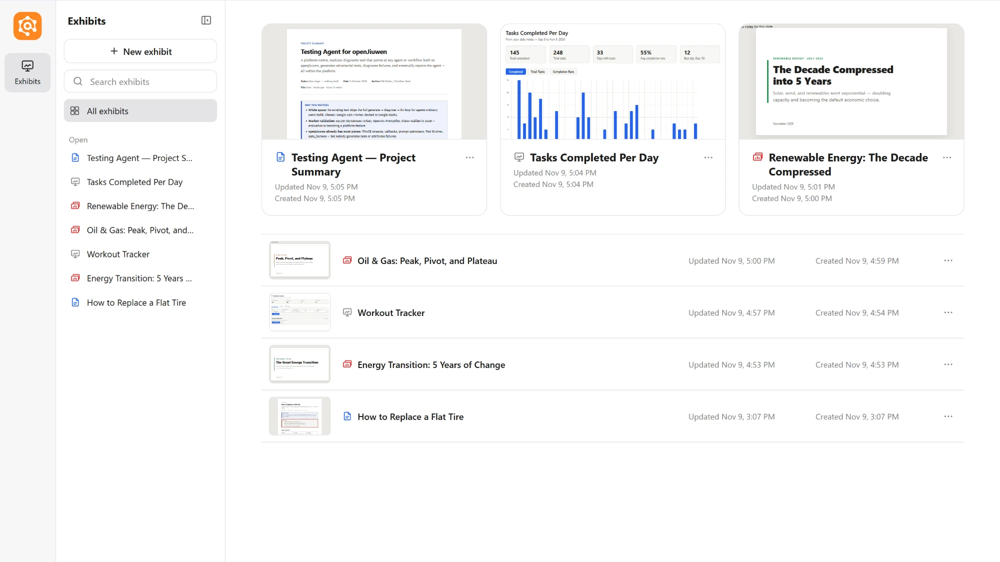
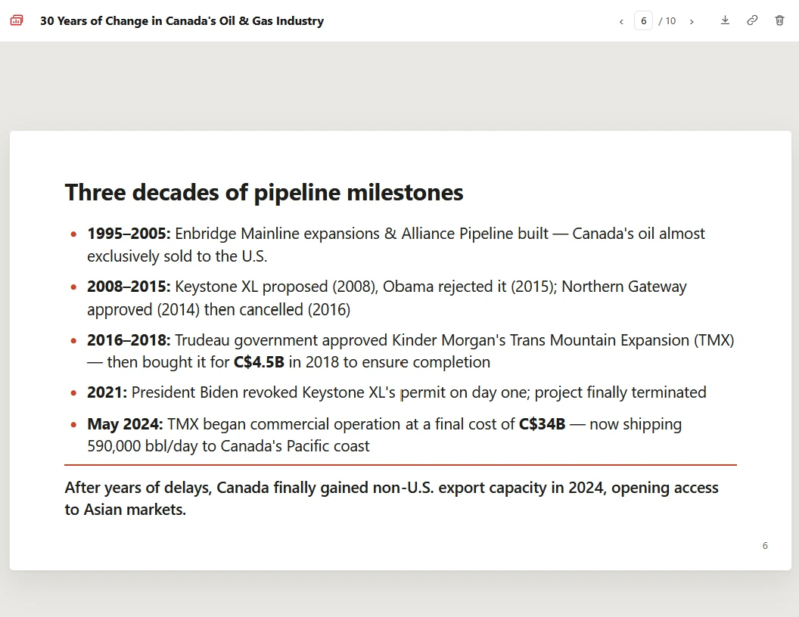
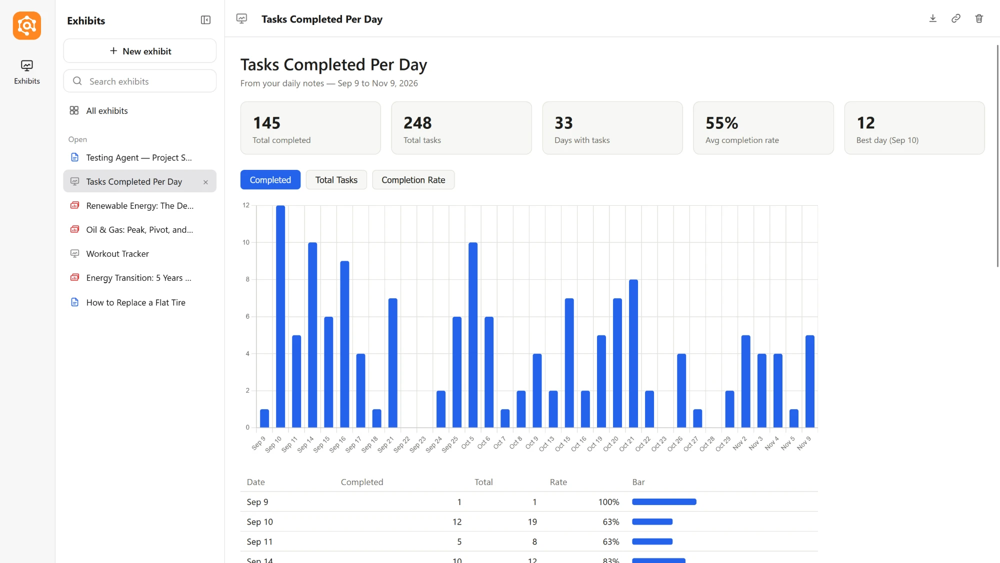

# Exhibit: interactive exhibits for WorkSwarm (prototype)

Exhibit lets the WorkSwarm agent build exhibits: documents, slide decks, dashboards, calculators, trackers, charts and small apps. They open in a sandboxed browser tab. Each exhibit keeps its versions and can save what you enter, which the agent can read back.

It's a prototype of Claude-style artifacts for WorkSwarm. ("Artifact" already means self-improvement outputs in WorkSwarm's backend, so each item here is an *exhibit*.) WorkSwarm's own HTML preview blocks scripts, and its built-in browser refuses `localhost`, so a plugin can only open exhibits in the user's default browser. The longer-term fix belongs in WorkSwarm itself (see "Why a plugin" below).



## What you get

- **Three formats.** Before writing a new exhibit, the agent asks which kind you want:
  - **Document**: reports, proposals, memos, letters, meeting notes.
  - **Slides**: a 16:9 deck.
  - **No preset**: a free-form page, such as a dashboard, calculator or tracker.

  Documents and slides start from a ready-made page, so they come out consistent and quickly. Free-form pages are written from scratch.
- **The All Exhibits page.** Every exhibit with a preview, search, your open exhibits as tabs, and an icon for each exhibit's format.
- **Versions and saved data.** Every change is a new version you can go back to. Exhibits can save what you enter (ticks, inputs, the slide you were on), and the agent can read it.
- **Export.** HTML for every exhibit. PDF for documents and slides. Markdown for documents.
- **Point at an exhibit in chat.** Paste a reference, or quote a passage you selected, and the agent knows exactly which exhibit and which part you mean.
- **Exhibits remember the chat they were made in,** so the agent can look up the conversation behind one.

## Formats

| | Document | Slides | Free-form |
|---|---|---|---|
| Looks like | US Letter pages, like a word processor | 16:9 slides, one at a time | Whatever the page needs |
| Top bar | Page control: ‹ 2 / 8 ›, type a number to jump | Slide control, plus arrow keys and swipes | — |
| Export | HTML, PDF, Markdown (.md, or .zip with images) | HTML, PDF (one slide per page) | HTML |

**An exhibit's format never changes.** The page control, the page layout and the exports depend on it, so a new version must be in the same format. To get a different format, make a new exhibit. (Switching formats is on the to-do list.)

**The plugin draws the controls, not the page.** The page layout, page numbers, slide navigation and slide size are added by Exhibit itself. An agent's edit can't break them, and older exhibits get them too.

### Document


- **The same pages on screen and in the PDF.** Paragraphs, tables and figures are never split across pages, and headings stay with what follows them.
- **Numbering:** sections, figures and tables number themselves.
- **Layouts:** report, one-page brief, memo or letter, and meeting notes. Ticks on meeting-notes actions are saved.

### Slides



- **Text fits.** A crowded slide shrinks its text to fit, down to 60%, and scrolls past that, so nothing is cut off.
- **Remembers your place:** the deck reopens on the slide you were on.
- **Speaker notes:** N shows them.

### Free-form



Anything a single HTML page can do, with charts from approved CDNs (for example Chart.js) and saved data.

## Using exhibits in chat

- **Refer to an exhibit:** use the link icon in an exhibit's top bar (or Copy reference in the gallery's ⋯ menu), then paste it into the chat. The agent is told the exhibit's versions, summary and saved data.

  ```
  @exhibit(Monthly budget #8d02e7) why is rent so high?
  ```

- **Quote part of it:** select text in an exhibit and click Quote. The reference and the quoted text are copied together, ready to paste:

  ```
  @exhibit(Monthly budget #8d02e7)
  > Rent | $1,500 | Fixed
  ```

- **Delete several at once:** "delete all my exhibits" shows one dialog listing them.

## How it works

- **One tool, `exhibit`,** with actions `show`, `preset`, `list`, `gallery`, `read`, `open`, `delete` and `stop`. Standard library only. It declares itself directly visible, because WorkSwarm's progressive tool loading would otherwise hide it behind `tool_search`.
- **One rail, `ExhibitAskRail`.** It uses the same interrupt as WorkSwarm's `ask_user`:
  - **Picking the preset:** before a new exhibit, it asks you to pick one (Document, Slides or No preset), plus "Answer in chat" if you didn't ask for an exhibit.
  - **Deletes:** it confirms every delete in a dialog.
  - **One question at a time:** WorkSwarm accepts only one answer at a time.
  - **Skill first:** it makes the agent load the exhibit skill before showing anything.
  - **Missing page:** it fills in the page the agent just saved when a `show` arrives without one.
  - **Script-filled HTML files:** it keeps `.html` files with scripts out of the file preview panel.
  - **Repeated failures:** it stops an identical failing call after 3 tries in a turn.

  It runs just before WorkSwarm's permission rail and removes its answer after reading it, since the permission rail otherwise denies the resumed call.
- **Presets** are sample pages under `plugin/exhibit/skills/exhibit/presets/`, each with a guidance comment for the agent. Each version records its format, and the tool refuses a version in another format (`preset_locked`) or a page missing the preset's structure (`preset_structure`).
- **Storage:** `~/.exhibit/exhibits/<exhibit_id>/` holds `v1.html`, `v2.html`, …, `meta.json` and `data.json`. Set `EXHIBIT_HOME` to move it.
- **Server:** a small HTTP server on `127.0.0.1` with a random port, started inside the agent process on first use. Every URL includes a secret token. Exhibits open at `/<token>/e/<exhibit_id>`.
- **Sandbox:** you see a trusted outer page (title, page control, versions, export) with the exhibit inside an `<iframe sandbox="allow-scripts …">` without `allow-same-origin`. The exhibit's own response also carries a CSP `sandbox` directive, so it stays sandboxed even if opened on its own.
- **Saved data:** the exhibit calls `window.exhibit.get/set/remove/all/clear`. These go by `postMessage` to the outer page, which is the only thing allowed to call the data API.
- **PDF export:** a hidden (headless) Microsoft Edge, or Chrome, prints a standalone copy of the exhibit straight to a PDF file, with the exhibit's usual content limits applied. There's no print dialog. If no browser is found, the print dialog opens instead.

### Security checks

| Threat | Defense |
|---|---|
| Exhibit reads other exhibits' data or calls the server | Opaque origin (sandbox without `allow-same-origin`), `connect-src 'none'` |
| Exhibit sends saved data to the internet | `connect-src 'none'`, `form-action 'none'`, images limited to `data:`/`blob:`; scripts and styles only from three CDNs |
| Websites the user visits call the server | Secret token in every path; data API refuses requests whose `Sec-Fetch-Site` isn't `same-origin` or whose `Origin` doesn't match |
| DNS rebinding | `Host` must be `127.0.0.1:<port>` or `localhost:<port>` |
| Outer page framed by another site | `frame-ancestors 'none'` |
| Prompt injection via saved data or quotes | The skill and the rail tell the agent to treat saved data and quoted text as data, not instructions |

Known gaps: scripts from the three CDNs are trusted; an exhibit can still beacon out through a CDN URL it builds (`script-src` allows those hosts). Any process running as the same Windows user can read `~/.exhibit`.

## Verified

- **In WorkSwarm 0.2.7** (model deepseek-v4-flash), all of the following worked end to end:
  - making documents, slide decks and free-form exhibits from the preset dialog;
  - editing them into new versions;
  - the All Exhibits page, deleting, references and quotes.
- **PDFs:** documents come out as US Letter pages that break where the screen pages do; decks as 13.33 × 7.5 in pages, one slide per page.
- **Unit tests:** 99 in total, 55 for the tool and 44 for the rail. Two of them render real PDFs and are skipped without Edge or Chrome. They run on Python 3.11 (WorkSwarm's version) with the real openjiuwen: `powershell -File plugin\run_tests.ps1`. That uses the AgentStudio venv; set `EXHIBIT_PYTHON` to use another 3.11 interpreter.
- **The rail's pause and resume,** and its ordering with the permission rail, run against openjiuwen's real interrupt code (AgentStudio venv, openjiuwen 0.1.17).
- **The sandbox,** in headless Microsoft Edge:
  - saved data persisted across loads;
  - Chart.js loaded from jsDelivr;
  - all five break-out attempts were blocked: server API, internet fetch, `localStorage`, reading the outer page, cookies.

## Known limitations (0.2.2)

- **Exhibits open in the browser, not inside WorkSwarm.** The way back to one is the link in the chat, or the Exhibits page and its tabs.
- **An exhibit's format can't be switched.** Make a new exhibit in the other format instead.
- **No photos from the web.** Images must be embedded in the page, so the agent draws diagrams instead of using real photos. Tool-side photo embedding is on the to-do list.
- **PDF export needs Microsoft Edge or Chrome.** Edge is built into Windows 10 and 11.
- **You always pick the preset;** the agent doesn't suggest one yet.
- **The New exhibit button isn't hooked up yet,** and page labels are English only.
- **Reinstalling the same version** may keep the old copy. Remove Exhibit under Extensions before importing a new build.

## Build and install

```powershell
powershell -ExecutionPolicy Bypass -File plugin\package.ps1
```

This writes `plugin\dist\exhibit-0.2.2.zip`. Import it in WorkSwarm under Extensions, the same way as the Obsidian CLI plugin.

## Why a plugin, and what WorkSwarm itself should do

A plugin can't change WorkSwarm's frontend, so exhibits open in a separate browser tab. Nine of the eleven Hub plugins with interfaces that we checked already run their own `127.0.0.1` servers for this; Exhibit could replace those one-off servers. The proper fix is in WorkSwarm: render exhibits inside the app with scripts enabled in an isolated origin, and support **MCP Apps** (SEP-1865), the interactive-UI extension Claude and ChatGPT use, so connectors can bring their own interfaces.
